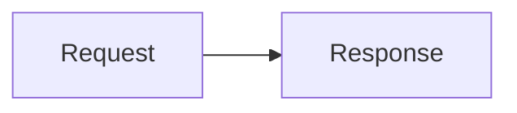

# Transcript Mermaid rendering

## Reference and reproduced defect

The unchanged extracted Conductor 0.87.6 renderer draws Request → Response for this invented assistant-message fixture:

Parent-provided REA evidence: renderer SHA256 `5199d392ef2dec92886393f181bc98531efc6251f75b9effecd9f60dc9515dde`; corrected receipt `ev_673febea4c6ef501ab11c6195c1e3da9fc1cdc84d61502e3e68cf5f354091ae2` passed all five steps. The earlier receipt `ev_f05090a74730308738f01088e6c0b9433c92c372f3f254186069b12a95047a09` failed its final wait on an incorrect SVG-ID selector and remains failed. Neither receipt proves native parity.

On main `97c34f6`, the actual Markdown component displayed raw source and zero `.md svg` elements. Running the new browser check against that original renderer failed its first SVG wait. The same check passes with this change.

[Original reference screenshot](https://api.reasonmachines.com/media/pr-screenshots/7fc44225-7251-4508-a043-37bec7369f6d/2d5a729fcc31d0f9d5f9dcf020e9ed5f/ref.png)

## Rendering boundary

`Markdown` routes only Mermaid fences to `MermaidBlock`. Ordinary fences keep the existing highlighting and copy control. The diagram starts as that same readable code, then a lazy bundled renderer replaces it with an accessible SVG plus expandable source. The result is keyed to its content; cancelled effects cannot publish obsolete output.

Mermaid and DOMPurify are pinned and bundled, not loaded from a CDN. Before parsing, the renderer rejects configuration directives/frontmatter, HTML, Markdown images, image/icon metadata, click/link actions, CSS declarations and external CSS constructs. Those features intentionally remain code, rather than enabling interactive or author-styled diagrams. Input is limited to 20,000 characters and 300 edges. Invalid and incomplete syntax stays code without an unhandled rejection.

Mermaid runs in strict mode with HTML labels disabled. A second boundary permits only inert SVG geometry/text and selected attributes. Links, images, foreignObject, scripts, styles and event attributes are not allowed; non-fragment paint URLs are removed. Trusted CSS uses app tokens so an existing SVG follows theme updates. This is not a claim of complete visual parity for every Mermaid diagram type.

## Checks on Reason Cloud

Dependency installation and checks used an isolated copy of this checkout and its dependencies. The shared `node_modules` directory was not changed. No existing dependency version changed in the lockfile.

- `npm run typecheck`: passed.
- `node --test src/features/chat/markdown.test.ts`: 13 passed.
- `npm run build`: passed, including TypeScript, branding and Vite bundling. Vite completed in 3m29s with its chunk-size advisory. The first isolated copy omitted branding assets; copying the tracked checkout fixed that setup error. A combined build/full-test command later timed out during tests; that full-test attempt is partial, not green.
- `node --test --test-concurrency=2 'src/**/*.test.ts'`: separate complete run passed all 1,339 tests.
- `npm audit --omit=dev`: zero production dependency findings for the selected lockfile. Existing development-tool audit findings were not changed.
- `node tools/chat/mermaid.browser.mjs --serve`: seven browser checks passed. On Reason Cloud this server/check command ran through `preview_start`, then the preview was stopped. The script also accepts `BASE_URL` for an already-running server and `OUT` for evidence.

Browser checks cover the exact accessible SVG, theme updates without source changes, source/copy payload, directives/frontmatter/HTML/images/actions/CSS/oversized/malformed/partial fallback, rapid content changes, normal highlighted fences/copy, and direct hostile-SVG sanitation. Request interception observed zero external HTTP requests during all tested parsing/rendering cases; zero page errors occurred. Clipboard writes are captured by a browser test double, not a system-clipboard proof.

These are stripped browser-fixture checks, not full-window geometry or native app proof. No native launch/input was performed. Exact-head CI and containing-main macOS package/browser checks remain separate delivery steps.
