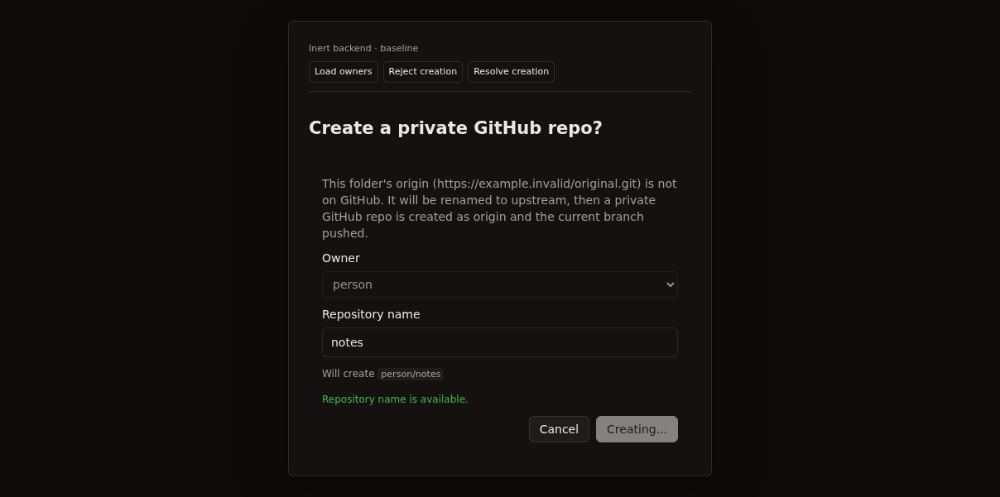
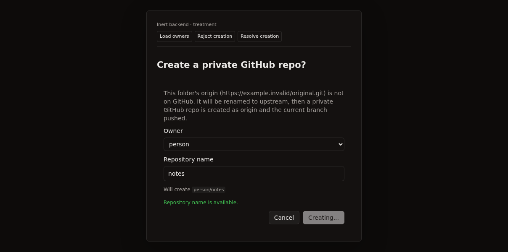

# GitHub Owner editability while creation is pending

Conductor Rebuild / SAME6013 / `GITHUB-OWNER-PENDING-6013`.

## Scope and retained reference

Fresh default `350276dac249fa14d24ec2460c5397a1e61cec97` disables Owner with `!ready || pending`. The retained Conductor 0.87.6 `was` dialog instead passes the owners-query `isLoading` value to `ah.disabled`; its creation mutation's `isPending` disables the primary action, not Owner.

[Source manifest](source.json) freezes 18 complete literal bindings through the normal local mount, owners producer/query, dialog, select root/trigger, native button and selection callback. The original renderer was rehashed before reading: 11,600,457 bytes, SHA-256 `5199d392ef2dec92886393f181bc98531efc6251f75b9effecd9f60dc9515dde`. The retained REA receipt is `ev_410f83a50764142c952de5f040cde338700477289c1687932071bdc5427c84b2`. Original JavaScript is untrusted data and was never executed. REA's original semantic renderer pass exhausted heap; these locked literal bytes supplement it, not a claim that analysis succeeded.

The only production change removes `|| pending` from the Owner select's disabled expression. Loading/error/refetch gates, owner reconciliation, provider calls, submit/duplicate guards, repository-name behavior and shared dialog code are unchanged. #959 addressed selected-owner reconciliation after retry, not this pending rule.

## Frozen reproduction and treatment

Before the production patch, the mounted actual component's new nine-test fixture was frozen at SHA-256 `d6f688f8f325a87144b17807ec6f0cbd832cd5469d723628b25927991c8b5229` together with the baseline component. It produced **7 pass / 2 intended failures**: Owner was disabled during pending creation, and the pending selection/rejection/retry flow could not begin. Both assertions check enabled state **before** invoking any selection callback; no disabled control was bypassed to claim success.

The identical frozen fixture after the one-expression fix produced **9/9 pass**. The first creation keeps its captured owner/path/name/origin, a changed draft owner cannot bypass duplicate protection, rejection preserves that draft, retry uses the draft, and success keeps the existing remote callback and closes once. Seven loading/idle/refetch/error/settlement controls passed on both sides. The actual `GitHubRepoDialog` and state model are loaded; only the outer `DialogFrame` and backend ports are synthetic. This does not exercise native selection or wrapper focus/keyboard/provider behavior.

Commands, on Reason Cloud:

```bash
node --experimental-strip-types --test src/components/githubRepoPendingOwner.test.ts
node --experimental-strip-types --test src/components/githubRepoOwners.test.ts src/components/githubRepoPendingName.test.ts src/components/githubRepoDismissal.test.ts src/components/githubRepoName.test.ts src/state/githubRepoDialog.test.ts
python3 evidence/dialogs/github-owner-pending/verify.py
```

The first command **passed 9/9 after reproducing the two expected failures**. The second **passed 19/19 before and after** without changing those files. The verifier **passed**, including all 18 original-asset span comparisons when supplied the retained renderer/index, exact product patch, frozen test identity and raw TAP counts. Raw RED output is retained byte-for-byte in gzip with [raw and packed hashes](raw-red-archive.json); assertion whitespace was not trimmed or regenerated. Both the ordinary portable verifier and explicit original-asset verifier are supported.

The fresh checkout lacked test dependencies. A bounded isolated nine-package fixture install supplied exactly React 18.3.1, react-test-renderer 18.3.1 and TypeScript 5.9.3 through `NODE_PATH` for those local commands. No lockfile, package manifest or shared dependencies were changed.

## Verification limits

The runtime retry control covers the existing organizations-error retry, **not** cached background-query refetch. The reference's owners-query `isLoading` rule and current `OwnersState` model are not claimed equivalent for all refetch/error states; this leaf preserves their existing current behavior rather than broadening the fix.

The exclusive heavy slot ran sequentially from 19:39:41Z and was released at 19:42:15Z, before its 19:44:41Z deadline. `npm ci --ignore-scripts --no-audit --no-fund` **passed**; `npm run build` **passed** (branding, full TypeScript and production Vite; existing large-chunk warning only); `npm run lint:colors` **passed** (six checker tests, 1,274-file scan). [Results and release receipt](heavy-results.json) and byte-exact compressed logs are retained. Own heavy process readback was empty.

## Frozen browser proof

The [six-control plan](frozen-browser/PLAN.md), fixture and complete 186-input graphs were frozen before the browser opened. The two graphs differ only in the actual GitHubRepoDialog source. Unlike the Node fixture, this browser fixture includes the actual DialogFrame, Base UI portal, motion, KeybindingsProvider and production theme/styles. An identical thin adapter adds clearly labelled synthetic backend controls inside the actual modal; no real backend or full App is loaded. The CSP denies connections, form actions, images and frames.

On Reason Cloud, the same six schedules produced **baseline 4/6 with two intended pending-Owner failures → treatment 6/6**. Baseline control 4 stopped at the enabled-state prerequisite, before any selection; the disabled baseline was never bypassed. Treatment preserved the original person request while Owner changed to team, kept primary disabled through the new availability check, made no duplicate after a real pointer attempt, retained the edited draft after rejection, retried with team and closed once with the team URL. Initial loading, idle selection, rejection without editing and successful resolution also passed on both sides.

All 32 raw DOM readbacks and 17 assertion requests are archived byte-exact as individual strings in [the compressed receipt archive](frozen-browser/raw-readbacks.jsonl.gz), with source IDs, revisions, timestamps and hashes in [its manifest](frozen-browser/raw-readbacks-manifest.json). The audit recomputes every control and intermediate flow predicate from those original receipts; owner, disabled and request fields are not normalized. Real pointer click/submit events were trusted. Select changes use the observed real select's native value setter with input/change dispatch and actual value readback: this is **not a trusted native picker interaction**.

Both matching pending screenshots were viewed and published:





```bash
node evidence/dialogs/github-owner-pending/frozen-browser/build.mjs
python3 evidence/dialogs/github-owner-pending/frozen-browser/verify.py
```

The first command built both bundles before browser admission; the second **passed** the frozen fixture/input identities, all 12 control verdicts, five intermediate flow readbacks and cleanup record. The browser ran within the admitted 19:49:41Z–20:04:41Z window. The owned tab was closed and preview stopped; tabs were empty, every own preview stopped/listening null, own server processes absent and an independent port-48733 bind passed. [Cleanup receipt](frozen-browser/cleanup.json): explicit release to ledger and the next Rust owner at **20:00:16Z**, more than four minutes before the deadline. No browser/server remains running.

## Remaining limits

Live-original side-by-side, currently installed original identity, full-App, macOS/WebKit, native, real-provider and packaged inclusion are **not verified**. The cached-background-refetch and native-picker limits above remain explicit. No native/Mac resource, credential, real repository creation or release custody was touched.
