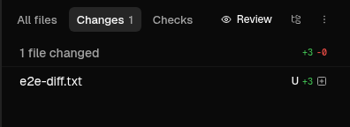

# Changes panel parity

Conductor Rebuild, 2026-11-06. This slice owns the Changes list and its tab-strip controls, not the chat, sidebar, terminal strip or shell.

## Reference identity

Read-only checks on Sven's authorized `sven m5 max` and the cloud cache agree.

- `/Applications/Conductor.app/Contents/MacOS/conductor` and the cached `conductor-0.87.6` both have SHA-256 `0ba55751aea5ecf592d2c78379760af641fb912a34b2c3573d41df031ffb831d`.
- The decoded frontend's `index.html` on both machines has SHA-256 `48b778fa0c04f73e55a744c99873cf8cafe942ba7613f24c533b0963b1cf411b`.
- Extraction provenance and REA's static analysis are in [the frontend evidence](../frontend/README.md). The retained analysis Evidence ID is `ev_b733d96728b664ae9af5923651b87c1bf86770b03ed36b85d35c81d72254a367`. That analysis does not fully model the large renderApp chunk.

No real playground, Bergen workspace, credential or repository working tree was changed. All displayed files are invented fixtures.

## Observed reference

The decoded `renderApp-D_fmY7hW.js` is untrusted reference data. Function names below are minified bundle names, not original source. Numeric offsets are JavaScript string offsets in that decoded chunk, not native addresses.

- `_ws` at 2,935,975 renders filter, tree/flat and Options controls in the panel tab strip. All changes uses an Options menu. Uncommitted and turn scopes replace that menu with a scope chip that returns to all changes.
- `yws` at 2,941,716 toggles `flat` and `tree`, with labels "Show folder hierarchy" and "Show flat list". `GBt` and `uys` default to flat.
- `dyi`, `cyi`, `uyi` and `rys` around 2,824,841 build a directories-first, naturally sorted tree, compress single-directory chains as `src / lib`, and start directories expanded. Collapsed directories show their descendant addition/deletion totals. `VBt=12`, `J4s=18` and `Z4s=.5` define the indentation and guide geometry.
- `syi` at 2,800,515 renders the directory muted, file name in the foreground, rename old/new paths, a U marker for uncommitted files, nonzero counts and a status icon. Hover swaps the metadata for discard and Open in controls. Viewed rows have 50% opacity.
- `G4s` at 2,808,965 draws a 32px summary row. The count is 14px muted medium text. Aggregate counts include zero; per-file counts omit zero.
- `u6s` at 2,738,174 keeps the actions outside the horizontally scrolling tab labels and uses an eye icon for Review.

REA browser captures corroborate flat, hierarchy, collapsed folders, Options and the three diff layouts. They run the real extracted frontend in the existing Tauri-IPC fixture, not a substitute reference UI.

## Implementation

`changesTree.ts` derives typed file/directory rows from the existing file tree builder. File rows keep the original `FileDiff` object. Opening a sorted, filtered or grouped file uses its path rather than the visible row index. Presentation state does not enter the diff fetch/cache key.

The old All changes/Uncommitted/viewed/Refresh toolbar is removed. `ChangesToolbar.tsx` puts scope choices in Options and keeps the target-branch picker. The existing review-comment controls remain below the list and disappear when empty. Uncommitted markers come from a separate zero-context uncommitted diff, never an assumption that every branch change is uncommitted.

## Reproduce

Reuse the supported decoded reference cache and installed REA 6.8.0. Install only the small `tools/screens` dependency in this checkout if it is absent. Do not clean-install the shared root node_modules.

Build the current code with `npm run build`. Start the capture server through Reason's `preview_start`, not a background shell server.

```bash
PORT=4398 CAPTURE=1 E2E=1 REA=/home/runner/rea/node_modules/.bin/rea TMPDIR=/tmp node tools/side-by-side/changes-panel.mjs .oc-tmp/changes-final
```

The one preview command runs the reference fixture and OpenConductor, then REA captures and right-panel E2E against isolated browser contexts. `REF_URL`, `DIST_REF`, `REA`, `STATES` and `PORT` configure the capture. The app preview requires `?oc_scenario=populated&oc_theme=dark`; `/__e2e/` deliberately has no injected page fixture because the test supplies its own.

Score the identical Changes rectangle from both 1280x820 captures. The crop is x=938, y=40, width=342, height=370. No recoloring, alignment shift or text normalization is applied.

```bash
REA=/home/runner/rea/node_modules/.bin/rea python3 tools/side-by-side/changes-score.py .oc-tmp/changes-before-corrected .oc-tmp/changes-final .oc-tmp/changes-scored
```

## Results

The corrected baseline is source `8e847380955088974ea268690a94581c45791264`. All final captures use source `45ce1af2143619b18324befa4a8c60286117a46d`, whose built index has SHA-256 `3fb3384975314a6a85a9f9e177ea7822bc879222820e8702316ece505b4cbe39`. [Capture metadata](changes-panel/captures.json) retains each REA capture ID, each original screenshot SHA-256 and the full-window compare record. [The panel comparison record](changes-panel/panel-report.json) retains the cropped comparison IDs and exact pixel counts.

Each percentage is one deterministic screenshot pair at channel threshold 24. It is not OCR, a semantic verdict or a performance measurement.

- Flat Changes crop improved from 5,672/126,540 pixels, 4.48%, to 3,491/126,540 pixels, 2.76%.
- Folder hierarchy is 2.60% and collapsed hierarchy is 1.87% in the same crop.
- Options is 5.23% in the crop. Its boundary bug is fixed, but small tone and spacing differences remain. This is not a complete pixel-perfect verdict.
- Full-window unified diff is 2.51%, split diff 2.69%, and entire file 2.83%. Their header, sidebar and terminal differences are visible in the retained images and belong to other owners.

The new Options boundary assertion failed before the measurement fix. A 220px popup initially measured at the entry animation's 0.95 scale caused an 11px overshoot. `ContextMenu` now measures `offsetWidth` and `offsetHeight`, and its optional end alignment is used only by Changes Options. The same browser readback is now exactly aligned, with 0px error. [Before/after boundary values](changes-menu-boundary.json) retain the observation separately from the 1280x820 REA comparisons.

Passed checks:

- `npm run build`, including TypeScript checking.
- `npm run typecheck`.
- `npm run lint:colors`.
- `node --test "src/**/*.test.ts"`, 1,256 tests.
- `node --test src/components/menu/dropdownPlacement.test.ts src/features/diff/changesTree.test.ts`, 11 tests.
- `OC_E2E_BASE=http://localhost:4398/__e2e node --test tests/e2e/right-panel.e2e.mjs tests/e2e/shell-context-menus.e2e.mjs`, 11 tests. The supported preview process ran this command against separate isolated browser contexts. [Full browser test output](changes-panel/e2e-output.txt) is retained.
- `git diff --check`.

[Interactive review page source](changes-panel/review.html) provides the seven inspected side-by-side images. Aggregate UI-map updates remain with the ledger owner.

## CI follow-up: live Changes refresh

The final E2E workflow on head `f45db332a71adaaed002b35ea6adeba15545166e` failed only App flows → diff: `timed out waiting for the Changes panel`. Its selector expected the removed Reload button. The Codex lane and the Reason lane's chat, picker, agent-binary, transcript and slash-menu steps passed.

Removing the stale test click alone was not sufficient: a browser regression confirmed that an external diff update never appeared after the initial empty load. [The before log](changes-panel/refresh-before.txt) records its 6-second timeout. `useWorkspaceDiff` now quietly reloads live worktree changes with a 2-second delay after each completed poll, without overlapping polls. Historical turn snapshots do not poll. Cleanup cancels scheduling when the worktree, target, options or selected turn changes or the view unmounts. Equal diff data reuses its file objects to avoid reloading the open whole-file viewer on every poll. This polling cadence is an OpenConductor implementation choice, not a newly verified Conductor behavior.

The native App flows diff check no longer clicks Reload; its exact filename and `+3` count assertions are unchanged. The focused browser regression now passes, along with the other 11 right-panel/shared-menu checks ([after log](changes-panel/refresh-after.txt)). The screenshot below is an unmodified crop from that Chromium fixture; it does not establish native Tauri behavior.



The follow-up also passed `npm run build` (including typechecking), `npm run lint:colors`, all 1,256 frontend unit tests, syntax checks for both changed E2E scripts and `git diff --check`. Full built-app CI on the new published head remains the merge gate. The existing skipped test from the wider browser suite is not covered by these 12 checks and remains a gap.

## Verification limits and corrections

- These are Chromium browser fixtures. No native Tauri/WebKit window, real git mutation, real external Open in launch or deployed desktop installation was verified by this slice.
- The source's commit-history choices in Options are not implemented. The matching fixture has no commit-history entries.
- The source persists view/collapse state by workspace route. This slice keeps the current panel state in memory and resets it on a worktree change.
- The first new capture driver omitted `oc_scenario=populated` on OpenConductor and captured Home. Its comparison is invalid and excluded from the verdict. The corrected baseline shows the actual Changes panel.
- The first external-base E2E invocation mistakenly injected the page fixture on `/__e2e/`. It timed out waiting for the panel and was stopped. The route exclusion is fixed; only the subsequent complete run counts.
- Existing REA limitations still apply. Static JavaScript search/large-bundle semantic coverage is incomplete, so bounded decoded-text reads supplement the retained analysis. See [REA gaps](../../tools/ui-map/REA-GAPS.md), especially the earlier JS search and browser capture entries. This pass encountered no new REA capability failure.
