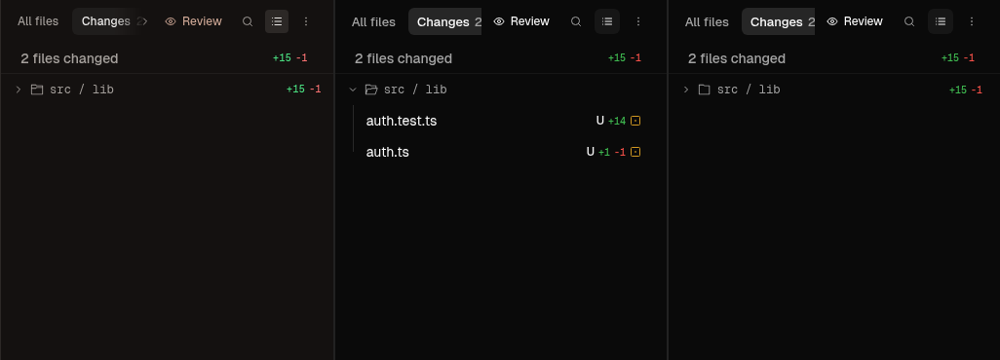

# Changes presentation retention

Conductor Rebuild, 2026-11-07. Follow-up to the merged Changes/discard work, not a replacement for it. Commit-history expansion is outside this slice.

## Reference and observed gap

The reference is the extracted frontend from the installed Conductor 0.87.6 app on Sven's authorized `sven m5 max`. Read-only identity checks agree with [the retained source identity](../changes-panel.md#reference-identity): executable SHA-256 `0ba55751aea5ecf592d2c78379760af641fb912a34b2c3573d41df031ffb831d`, decoded index SHA-256 `48b778fa0c04f73e55a744c99873cf8cafe942ba7613f24c533b0963b1cf411b`.

REA's retained static analysis is `ev_b733d96728b664ae9af5923651b87c1bf86770b03ed36b85d35c81d72254a367`. Large-chunk semantic coverage remains incomplete. Bounded reads of the decoded, untrusted bundle supplement that analysis: `WBt` uses the `workspace.changes` route with workspace ID scope; `GBt` reads `diffFileListMode`, `hys` reads `collapsedDirectoryPaths`, and `qBt` reads `filePathFilter`. Existing REA gaps remain in [REA-GAPS](../../../tools/ui-map/REA-GAPS.md). No new REA capability bug was established. Initial capture requests had a wrong fill schema and wrong OpenConductor workspace selectors; corrected requests alone count.

The real extracted reference frontend keeps `src / lib` collapsed after All files then Changes. OpenConductor reopened it because ChangesList cleared its local collapse set when the tab temporarily supplied an empty file list. [The failing browser regression](browser-before.tap) records `collapsed folders survive a panel-tab switch`, actual `true` versus expected `false`.

## Source change

Source-content commit `a7978f063f063f9501957bb36a063b811ca162f0` adds a workspace-keyed `ChangesPresentationStore` behind `useChangesPresentation`. It uses the existing native route-user-state storage contract and browser fallback. ChangesList receives controlled collapse state instead of resetting it as files change. The store preserves sibling routes and unknown per-route fields, validates known fields independently, serializes writes, and replays pending operations against hydrated values. Failed reads do not save an empty envelope. A later edit retries the read once.

Two startup faults were found during the same-model read-only review. Both new regressions failed before their corrections in [review-before.tap](review-before.tap): an early collapse operation lost already-saved paths, and a failed read overwrote unseen sibling routes. [All seven storage tests now pass](storage-after.tap). Reviewer `openai/gpt-6.1-sol` rechecked both corrections and found no remaining fault in that scope. This was not an independent cross-model review.

## Viewed browser evidence



Left: extracted Conductor frontend. Middle: OpenConductor before. Right: OpenConductor after. Each panel is an unchanged crop at x=938, y=40, width=342, height=370 from a 1280×820 screenshot. No alignment, recoloring, field normalization or text substitution is applied. The row stays collapsed in reference and fixed app; it reopens before the fix.

Full screenshots are retained for [reference collapse](ref-collapsed-return.png), [before collapse](before-collapsed-return.png), [fixed collapse](oc-collapsed-return.png), [reference filter return](ref-filter-return.png) and [fixed filter return](oc-filter-return.png). The filter-return pair shows `test`, `1 of 2`, and only `auth.test.ts` after switching away and back. All five screenshots and the comparison image were viewed before publication.

[Capture report](capture-report.json) retains REA IDs and original screenshot hashes. The final built index SHA-256 is `030063f30928cd7e4d5a417bb6c252ea7862837b0899a008edb0dc0ea308d374`. The capture process started while HEAD was `1730f722ccd1b91393d9c094f98e322978da9eff` with the final source uncommitted, so that is the raw report's `source_commit`. Its working-tree content was committed unchanged as `a7978f063f063f9501957bb36a063b811ca162f0` during capture. `git diff --exit-code a7978f063 -- src tests/e2e/right-panel.e2e.mjs tests/e2e/right-panel-fixture.mjs tools/side-by-side` passed after capture. The report has not been rewritten to conceal this distinction. [SHA-256 manifest](sha256.json) records retained evidence bytes and capture inputs/DOM readbacks.

The full-window pixel ratios in the raw report are not a native parity score. Shell differences outside Changes remain visible and belong to other lanes.

## Checks and reproduction

Final source passed:

- `npm run build`, including `tsc --noEmit`: [build output](build-after.txt).
- `node --test 'src/**/*.test.ts'`: [1,332 passed, none failed or skipped](frontend-after.tap).
- `node --test src/features/diff/changesPresentation.test.ts`: [7 passed](storage-after.tap).
- `npm run lint:colors`: [passed](colors-after.txt).
- `OC_E2E_BASE=http://localhost:48138/__e2e node --test tests/e2e/right-panel.e2e.mjs tests/e2e/shell-context-menus.e2e.mjs`: [15 passed, none failed or skipped](browser-after.tap). The new check covers tab retention, workspace isolation, reload, layout, filter reveal without deleting saved collapse, and clearing the stored filter.
- Syntax checks for the changed capture and fixture scripts and `git diff --check`: passed.

Start the server through Reason's supported preview tool after building. Use separate free ports:

```bash
PORT=48138 REF_PORT=48137 E2E=1 CAPTURE=1 STATES=collapsed-return,filter-return REA=/home/runner/rea/node_modules/.bin/rea TMPDIR=/tmp node tools/side-by-side/changes-panel.mjs .oc-tmp/changes-persistence-reproduced
```

The reference cache must match the installed app identity. All files and conversations in these captures are synthetic fixtures. The final build was interrupted once when this checkout's dependencies disappeared during shared-machine work. The direct compiler path was absent too. Only this checkout's dependencies were restored with `npm ci --ignore-scripts`; the subsequent full build and tests above passed. No package versions or lockfile changed.

## Limits

This is synthetic Chromium behavior, not native Tauri/WebKit, a deployed desktop build, a real git discard or an external Open in launch. Native access remains exclusive in the logo → Home → retention queue and requires explicit releases. No installed app, PID54473, credential, playground, Bergen workspace or scratch tree was changed. Commit-history options and the previously skipped broader-browser check remain unverified, not silently covered by these 15 focused checks. Exact-head CI/workflows and consuming builds are tracked in the PR rather than assumed from local checks.
