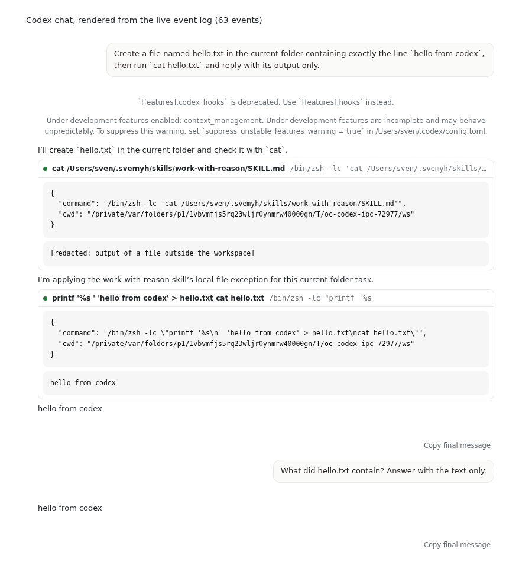

# Codex end to end on "sven m5 max"

These runs exercised the Codex app-server provider of OpenConductor against the real, signed-in `codex` CLI on Sven's Mac. Conductor Rebuild ran them on 2026-11-05 on branch `reason/openconductor-codex-real-d7cfb60d` (PR #275).

## Machine

- "sven m5 max", macOS 26.4, arm64. The screen was locked for the whole run.
- `codex-cli 0.166.0` at `~/.local/bin/codex`. `codex login status` reports "Logged in using ChatGPT".
- The app found the CLI by itself through `codex_cli_path`, which reads the login shell's PATH. No path was configured.

## What ran

| # | Check | Command (in `src-tauri`) | Result |
|---|---|---|---|
| 1 | Full desktop crate lints clean | `cargo clippy --locked --all-targets -- -D warnings` | pass |
| 2 | Codex unit and integration tests in the app crate | `cargo test --lib codex` | pass, 32 tests |
| 3 | Runner against the real CLI | `OPENCONDUCTOR_CODEX_BIN=~/.local/bin/codex cargo test --lib live_signed_in_codex` | pass: the turn ended `Completed` and the reply contained "pong" |
| 4 | The app's own Tauri commands against the real CLI, with "Ask first" (`on-request`, `workspace-write`) | `OPENCONDUCTOR_CODEX_IPC_E2E=<log> cargo test --lib live_ipc_chat` | pass: 2 turns completed, `hello.txt` written in the workspace, both final answers "hello from codex", 4 tool events. Codex asked for no approval, because its sandbox allows writes in the workspace. Log: `codex-ipc-events-ask-first.json` |
| 5 | Same as 4, with approval `untrusted` | same command | pass: Codex asked before each command, every approval was answered Allow through `codex_answer`, and both turns completed. In the recorded run Codex asked once, before `printf ... > hello.txt; cat hello.txt`, offering `accept` and `cancel`. Log: `codex-ipc-events-untrusted.json` |

Test 4 and test 5 are `codex_chat::tests::live_ipc_chat_with_the_signed_in_codex`. Each builds the app's command set on Tauri's `MockRuntime` and calls the commands through IPC with the same JSON the frontend sends (`src/features/chat/codexChat.ts`):

1. `codex_cli_path`
2. `codex_open_chat {chatId, cwd, threadId: null, policy}`
3. `codex_prompt {chatId, text}`, twice
4. `codex_answer {chatId, requestId, decision: "accept"}` for each `approval` event
5. `codex_close_chat`

The test records every `codex-chat-event` the app emits and asserts:

- one `threadStarted` for both prompts
- two `turnEnded` events
- every event carries the `chatId`
- each turn has a `final_answer` message containing "hello from codex"
- the file is in the workspace
- in test 5, at least one approval

The only route to the real CLI is through the running app's commands. A GUI walk of the built app on the Mac was not possible: the screen is locked, macOS WebKit has no WebDriver, and Reason's worker there has no Screen Recording or Accessibility permission (see `README.md`). The GUI flow is covered in CI by `tools/e2e/codex-chat.e2e.mjs`, which drives the built app over WebDriver on Linux against a stand-in app-server. The stand-in replays this turn, so the CI run covers clicking the agent and access menus, the approval card, Stop and "Deny and stop".

## What the app shows for the real turn

`screens/codex-live-transcript.png` is the event log from test 4, fed through the app's own Codex mapper (`src/features/chat/codex.ts`) and transcript component (`Transcript.tsx`), with the app's CSS. `tools/e2e/render_codex_events.tsx` does the rendering. The image shows the prompt and Codex's commentary messages, with the two command rows between them and their output. It also shows the final answer, the follow-up on the same thread, and the two config warnings Codex sent at thread start, shown as notices.

## Redaction

Sven's own Codex instructions make Codex `cat` a personal skill file outside the workspace before it works. That file's text was replaced in the committed logs by `tools/e2e/redact_codex_events.py`. The command and its path are kept. Nothing else was changed.

## Observed from the real CLI

- Codex logs `failed to connect to Responses WebSocket` on stderr at the start of each run, then completes the turn. The runner logs stderr and does not fail on it.
- At thread start Codex sends `configWarning` and `deprecationNotice` notifications about Sven's `~/.codex/config.toml`. They show as notices.
- Under `on-request` with `workspace-write`, Codex ran `cat` outside the workspace and wrote inside it without asking. Under `untrusted`, it asked before each command. Approval requests carry `availableDecisions`, which the 0.166.0 schema omits (see `../providers/codex-app-server.md`).
