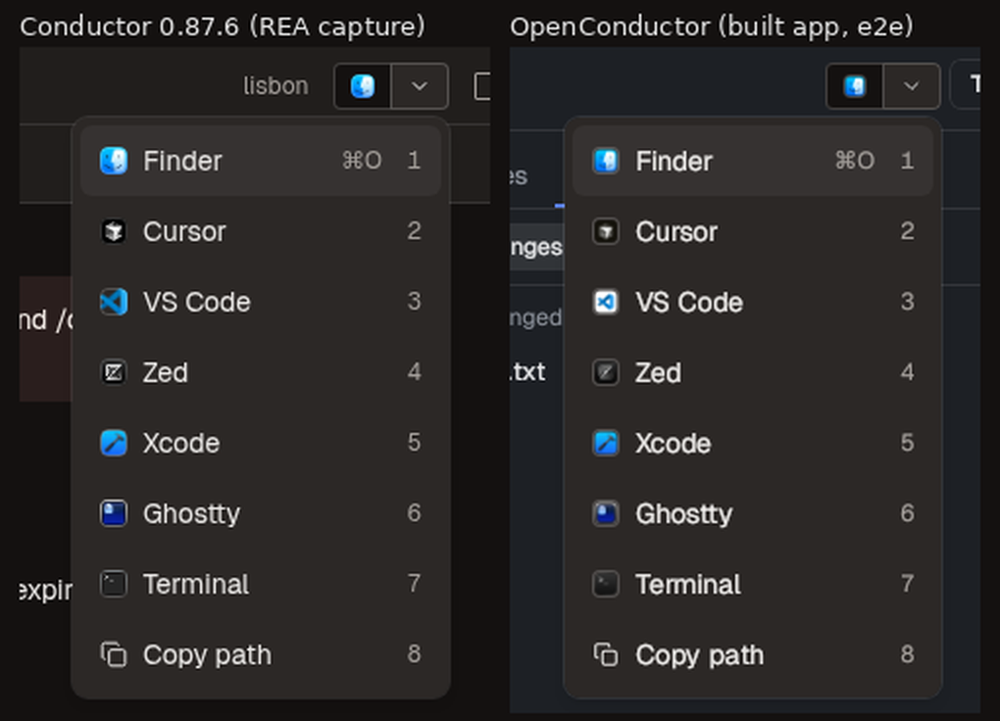
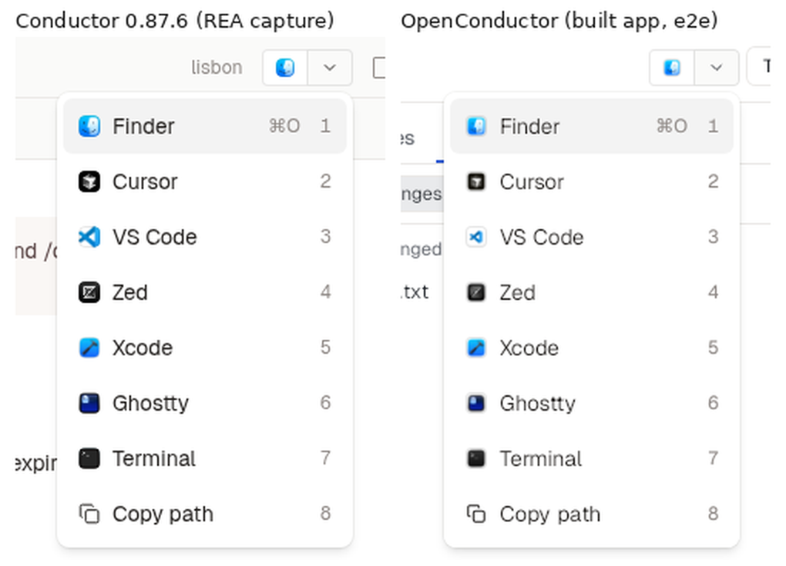

# Header Open button and "Open in" menu (`ui.open-in-editor`)

Reference: Conductor 0.87.6, frontend chunk `renderApp-D_fmY7hW.js` (sha256 `5199d392ef2dec92886393f181bc98531efc6251f75b9effecd9f60dc9515dde`) from the app's embedded Tauri asset table. The code was read as data. REA runs are in [rea-invocations.tsv](rea-invocations.tsv).

## How Conductor does it

| What | Conductor (minified name) | OpenConductor |
|---|---|---|
| App catalog: 37 apps with display name, bundle name, icon kind, `alwaysAvailable` (Finder, Terminal), `toolboxId` (JetBrains) | `sX` | `CATALOG` in `src-tauri/src/open_in/mod.rs`, same order |
| Installed check: `/Applications/<App>.app` or `~/Applications/<App>.app`; for JetBrains, also `~/Library/Application Support/JetBrains/Toolbox/apps/<id>`; for Xcode, also `xcode-select --print-path` matching `Xcode.*\.app`. Cached for 1 h. | `Z_s`, query `connectedApps` (staleTime 1 h) | `Roots::available`; frontend cache `APPS_STALE_MS` |
| Menu order: catalog order, installed apps only | `P9` → `ve` filter | `available_apps` |
| Default app: the saved `default_open_in` if it is offered, else the first offered app | `P9` (`ye`) | `defaultAppId` |
| Header button: split outline xs button. The left half shows only the default app's icon (`showLabel: false`) and opens in that app, with tooltip "Open in <App> ⌘O". The chevron half has tooltip "Open in..." and opens the menu. | `ICi` → `P9` | `OpenInButton` |
| Menu: `w-48 p-1`, aligned to the end, offset 4. Rows: icon (size-3.5) and name; the default row shows the `workspace.openInApp` shortcut; number keys 1-9; then "Copy path" with the next number. "No apps available" when the list is empty. | `bvs`, row `X7t`, `J7t = 9` | same |
| Keys: ⌘O opens in the default app, ⌘⇧O opens the menu, 1-9 pick a row while the menu is open, ↑/↓ move and wrap | `workspace.openInApp`, `workspace.openInMenu`, `cJe` (`menu.selectItem1..9`), `_vs` | same registry commands |
| Copy path: copies the folder and shows the toast "Copied workspace path to clipboard" | `n5(value, gvs("workspace"))` | `copyPath` |
| Choosing an app: record it as `default_open_in` and move it to the front of `open_in_mru_order`, then open | `eii` → `record_open_in`, `uD` | `recordOpenIn` then `open_in_app` |
| Opening a workspace folder on macOS: Finder runs `open <dir>`, Xcode runs `xed <dir>` (falls back to `open -a Xcode`), all other apps run `open -a <App> <dir>` | `uD`, `I8`, `o4e` | `macos_open_command`. Conductor runs these through a shell string; we run argv directly, without a shell. |
| Icons: the menu uses icon PNGs that Conductor ships (`/app-icons/*.png`). For its app switcher, Conductor converts each installed app's `CFBundleIconFile` .icns to a 128 px PNG with `sips`. | `KH`, `gLr` | We ship no third-party icons. `icon.rs` reads the app's own `CFBundleIconFile` .icns and uses its smallest PNG that is at least 64 px wide. Without an icon, the row shows the folder, code or terminal glyph, as `KH` does for apps that have no icon. |

## Parity on the built app

Both images come from the headless e2e lane: `tests/e2e/run.mjs`, flow `open-in`, using the debug build, tauri-driver, WebKitWebDriver and Xvfb. The flow installs stand-in bundles for Sven's set of apps in `~/Applications` (`tests/e2e/fake-apps.mjs`). For these local shots, `OC_E2E_ICNS_DIR` pointed at the real .icns files copied from "sven m5 max". In CI the bundles get one-colour placeholder icons. The left side of each image is the Conductor reference, [menu--open-in--dark.png](../screens/menu--open-in--dark.png) and [menu--open-in--light.png](../screens/menu--open-in--light.png), which REA's `capture-browser-scenario` took in the screens harness. In that run the harness's fake shell answered `Z_s` as a Mac with Cursor, VS Code, Zed, Xcode and Ghostty.

Both menus have the same rows, numbers, ⌘O hint, width, padding and colours.

Differences that remain:

- Icon artwork. Conductor's bundled PNGs fill the whole square. The apps' own macOS icons have the standard transparent margin, so the icons look smaller, and VS Code shows its macOS tile, not the flat logo.
- The rest of the header. Conductor puts the directory name before the button and the right-panel toggle after it. OpenConductor's header still has its Terminal and Archive buttons. Both are outside this change.
- ⌘O. In Conductor, ⌘O shows an app switcher overlay while held (`Eco`, `o9`): a strip of recent apps that you cycle by pressing O again. Here ⌘O opens the default app at once, which is what the button's tooltip advertises. The switcher is not built.
- Remote and cloud workspaces (`ssh-remote`, the local mirror for Finder) and file-level opens with `--goto <line>` are not built. Only local workspace folders open.
- Linux: Finder opens with `xdg-open`. Every other app returns "Opening in <App> is only supported on macOS".

## REA gaps and bugs hit

1. `trace-javascript-semantics` with `direction: callers` on `P9` returns 0 relations, yet `ICi` renders `P9` through `p.jsx(P9, {...})`. A component that is passed to `jsx()` is not modeled as a call or reference edge. The same holds for `bvs`, `X7t` and `KH`. The whole component tree (`ICi` → `P9` → `bvs` → `X7t`) was read from the slice text instead.
2. `analyze-javascript-application` keeps only 13 `literal` nodes for 36 KB of source. Object-literal and template strings come back as unlabelled "string literal" nodes with no value: the catalog's app names, the `test -d "/Applications/…"` command template and the menu labels. These strings cannot be recovered from the graph, so the catalog was copied from the slice text.
3. `trace-javascript-semantics` rejects `seed.value` and `direction: callees`. It needs `seed.fingerprint_sha256` and one of `backward-provenance | forward-influence | callers | ownership`. An earlier input in `~/rea-status` used the old shape and failed with `invalid_request`.
4. No capture of the native app. The Mac's screen was locked during this run (`screen_lock: locked`), and REA's native capture needs Screen Recording and Accessibility. The reference therefore comes from the extracted frontend in headless Chromium, not from WKWebView.
5. `tools/screens/capture.mjs` wrote a hard-coded `rea-agents 6.7.0` into the manifest, while the installed REA is 6.8.0. It now reads `rea --version`.
