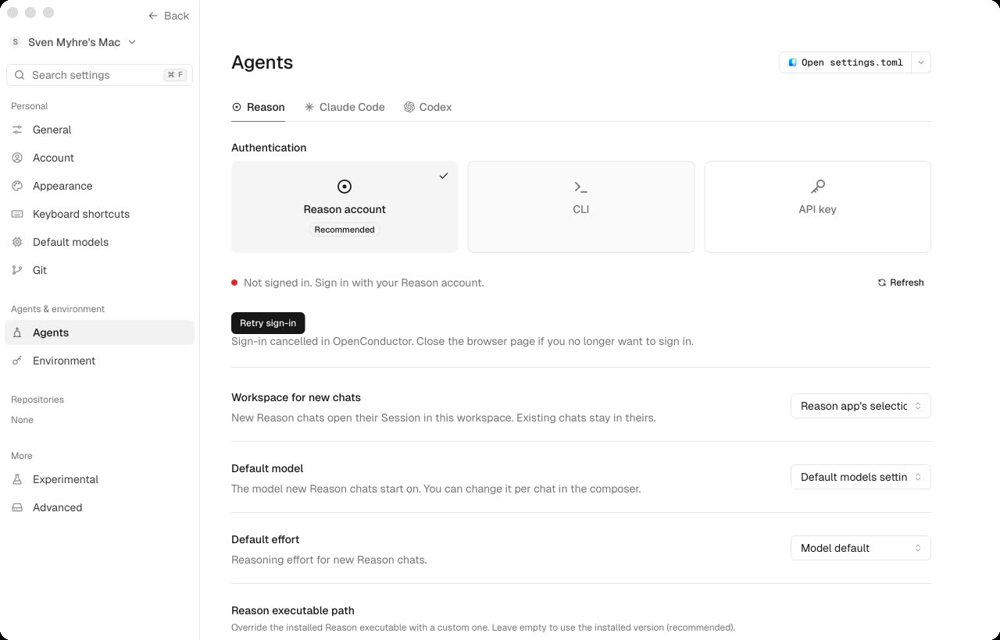

# Native browser handoff — partial proof

Conductor Rebuild drove the built OpenConductor app on **sven m5 max**, using actual native computer controls on 7 November 2026. This receipt is not successful browser sign-in or inference proof.

## Observed

- Fresh canonical mode-0700 HOME and a separately created mode-0600 keychain. The default and search keychain lists were unchanged. CLI `status --json` exited 0 with no account, account error, organization, workspaces, connection or installation.
- Retained native package at source `3992181323b963eebee5ad383672e615dac65368`; binary hash and clean source verified again. Compared with PR #753 head `79d31a3cad22612c10b639a345e3d53c774eb351`, the production runtime sources are unchanged. The only source-tree difference is an added Rust test. This run did **not** rebuild the package.
- Installed real Reason CLI **0.2.707**. No credential copying, terminal sign-in, invented login flags or loopback flow.
- Native clicks: **Continue without signing in → Settings → Agents → Sign in with Reason**. The app moved from signed out to preparing sign-in, then **Finish signing in in the browser window**, with a confirmation code, Cancel and reopen controls.
- **Cancel** produced **Retry sign-in** and the cancellation explanation. The exact owned app process was then stopped and the native slot released. No unrelated process was stopped or installed app replaced.

## Blocked, not passed

The personal Chrome profile was not connected; the machine browser exposed no tabs. A Chrome access card was shown. **Browser approval in Reason Tests, Connected, workspace selection and a real Reason turn remain unverified.** The remaining proof must use actual browser approval, not auth injection or copied credentials. Cancel stops the app attempt but does not revoke the CLI's detached browser approval link; no global logout was invoked.

The screenshot below is the actual native cancellation state, saved unchanged from the computer-use result after viewing. It contains no pairing URL, code or token. The waiting-state image was not exported. Shell capture failed even for the on-screen owned window, so the native provider image is used.

[Machine-readable receipt](receipt.json) · [Prior build and preapproval receipt](../native-macos-3992181-preapproval.json)

No Conductor behavior or visual-parity claim is made by this receipt.
