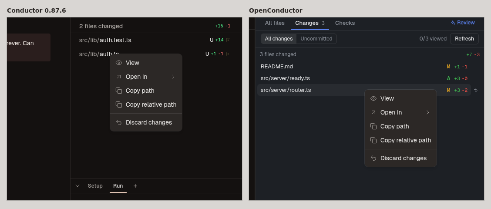

# Right-click menus on the chat, diff and PR screens

Conductor 0.87.6 builds every right-click menu with Base UI's `ContextMenu`
(renderApp-D_fmY7hW.js: `kS` root, `A6` trigger, `gy` content, `L1` item,
`aye` separator, `J4` shortcut, `TFt`/`AFt` submenu). Every place it mounts `gy`
was listed from the bundle and resolved to its owner element; strings and code
were read as untrusted data. OpenConductor's equivalent is
[src/components/ContextMenu.tsx](../../../../src/components/ContextMenu.tsx).

## Shared menu look and motion (from `gy` / `L1` / `aye` / `J4` / `TFt` / `AFt` classes)

| Property | Conductor | OpenConductor |
| --- | --- | --- |
| Popup | `min-w-32 p-1 rounded-lg ring-1 ring-popover-ring bg-popover shadow-md` | `.cm`: 128px min, 4px padding, 8px radius, 1px ring, shadow-md |
| Placement | side right, sideOffset 2, align start, flip/shift in window | `placeMenu` (unit-tested) |
| Open/close | `transition-[opacity,scale] duration-100`, starting/ending style `opacity-0 scale-95`, origin at the pointer corner | same, `data-starting-style` / `data-ending-style` |
| Item | `gap-2 rounded-md px-2 py-1.5 text-sm`, icons `size-4` muted | `.cm-item` |
| Hover / keyboard highlight | `data-[highlighted]:bg-popover-accent text-accent-foreground` | same tokens |
| Disabled | `opacity-50 pointer-events-none` | same |
| Separator | `-mx-1 my-1 h-px bg-border` | `.cm-sep` |
| Shortcut | `ml-auto pl-4 text-xs tracking-widest text-muted-foreground` | `.cm-shortcut` |
| Submenu | trigger `rounded-sm` + chevron-right; popup `rounded-md border shadow-lg`, sideOffset 0 | `SubMenu` |
| Icons | lucide, CSS `.lucide{stroke-width:1px}` non-scaling | 1px non-scaling stroke |

## Menu inventory (Conductor menu -> our element -> status)

| Conductor menu (owner) | Where | Items in order | OpenConductor element | Status |
| --- | --- | --- | --- | --- |
| `Svs` via `syi` | Changes list row | View (eye), Open in ▸ (arrow-up-right; apps with `supportsFileOpen`, number keys), Copy path (copy), Copy relative path (copy), ─, Discard changes (undo-2). Attach in chat only where the caller passes `onAttach`; `syi` does not | `FileContextMenu` | fixed in this PR (icons, Open in ▸, toasts, look) |
| `u6s` | Right panel Review button | Edit before sending (disabled in a read-only workspace) | `ReviewButton` | fixed in this PR (shared menu; disabled when archived) |
| `u8i` | Chat tab | see the chat-tab row below | `MainTabs` | see below |
| `RFt` -> `w_i` | Header PR pill | see below | `PrControl` | see below |
| `sKo` -> `w_i` | PR tab title `#N` | see below | `PrTab` | see below |
| `EQ` (`cEi`) | Links in chat markdown | Open in Finder (file links only), Copy link address / Copy file path | Transcript markdown | see below |
| diff viewer file headers | — | Conductor mounts no context menu there | — | match (none) |
| Checks rows | — | no context menu | — | match (none) |
| `Svs` via `Bvs` | File tree | same menu | file tree (other owner) | out of scope |
| `Plo`, `e9a`/`t9a`, `zOo`, `Lna`, `gJn`, `h0a`, `bro` | W-N chip, settings nav, members, Roundhouse | — | other owners | out of scope |

## Captures

`tools/context-menus/capture.mjs` opens each menu with REA
`capture-browser-scenario` (right-click step) in Conductor's extracted frontend
(tools/screens harness, `populated` fixtures) and in OpenConductor's Vite build,
records REA `compare-web-screenshots` (channel threshold 24) and renders the
side-by-side crop through REA. Hashes and evidence ids: [captures.json](captures.json).

## REA gaps and harness issues hit

- `rea capture-browser-scenario --schema` prints only `{inputJson: string}`; the action
  schema (for example `click` with `button: "right"`) had to be read from REA's
  bundled zod schema in `rea-agents/dist/cli-runtime/browserScenarioValues-*.js`.
- With the session's long `TMPDIR`, capture-browser-scenario fails with a generic
  `execution_failure` ("run rea doctor") and no step detail; `TMPDIR=/tmp/t` works.
- A failed action step returns a normal envelope without a screenshot; only the
  per-step `error` says why (for example a 5 s click timeout while the page boots).
- No REA view addresses a minified function by name; menus were sliced from the
  bundle by name with a small brace matcher and formatted with prettier.
- Harness: Conductor's extracted dist ships no Geist font files, so reference
  captures fall back to a system font unless the capture overlays them (done here
  with OpenConductor's byte-identical files, without touching the shared dist).
- Harness: `tools/screens` needs `npm ci` there (sql.js) before server.mjs serves.
