# Tooltips on the chat, diff and PR screens

OpenConductor now has one shared tooltip primitive that follows Conductor 0.87.6, [src/components/ui/Tooltip.tsx](../../../../src/components/ui/Tooltip.tsx). The chat, diff and PR buttons use it in place of native `title=` attributes.

## Two primitives on main

While this branch was open, #491 (sidebar) landed `src/components/Tooltip.tsx`. That one is a hand-rolled tooltip with the same visual tokens and a glyph-string `shortcut`. This PR adds `src/components/ui/Tooltip.tsx` on Base UI, which is the library Conductor ships. It adds `ShortcutHint`, which takes a commandId and follows remaps, plus align, collision flip and shift, and Base UI's delay group. The two use separate class names (`oc-tooltip` and `oc-tip`), so they do not style each other. The sidebar's "Settings ⌘," tooltip was checked after the rebase and still opens. The follow-up is to move the sidebar call sites to this primitive and delete the hand-rolled one; that is left to the sidebar owner.

## What Conductor does (from `renderApp-D_fmY7hW.js`)

| Part | Conductor | OpenConductor |
|---|---|---|
| Library | Base UI Tooltip (`Uli` Root, `Wli` Trigger, `kLt` Positioner, `TLt` Popup, `CLt` Portal) | `@base-ui/react` 1.9.0, the same parts |
| Provider | `nci` at the app root (`jTa`), **no delay**, so Base UI's group timeout of 400 ms applies | `TooltipProvider` in `src/main.tsx`, `timeout` 400 |
| Delay | Trigger default `sRn = 600` ms, close delay 0. Neighbours open at once within 400 ms of a close. Only 2 sites override it with `Jn delayDuration`: 0 (model-config info icon `g7o`) and 100 (settings Esc `I9a`). Neither is on these screens. | No `delay` given, so 600 ms. Measured: hidden at 350 ms, open at 644-708 ms |
| Content (`ni`) | `side` top, `sideOffset` 4, `collisionPadding` 8, `align` unset (center), no arrow, no max width | Same defaults. Measured gap is 4 px on both sides |
| Classes | `rounded-sm ring-1 ring-popover-ring bg-popover/50 backdrop-blur-md pl-2 py-1 text-xs tracking-wide text-popover-foreground shadow-md`, plus `pr-1` when a `<kbd>` is a direct child, else `pr-2` | [ui/tooltip.css](../../../../src/components/ui/tooltip.css) resolves the same tokens (`--popover`, `--popover-ring`, `--popover-foreground`, `--muted-foreground` from `evidence/frontend/css-tokens.json`) |
| Animation | `data-[starting-style]` and `data-[ending-style]`: opacity 0, scale .95, `transition-[opacity,scale] duration-100`, ease `cubic-bezier(.4,0,.2,1)` | Same |
| Shortcut hint (`Ss`) | `jde(commandId)` follows the user's overrides. It shows `key` plus `additionalKeys` joined by "or", each as `inline-flex items-center text-xs text-muted-foreground`, inside `inline-flex items-center ml-auto pl-1`. Glyphs come from `mQt`/`gQt` (⌘⇧⌃⌥↵…); Enter is the `corner-down-left` icon (`gf`). An unbound command shows nothing. | `ShortcutHint` reads `effectiveShortcuts(commandId, overrides)` from `src/keybindings`, so remaps show up right away. Pure logic is in `tooltipModel.ts`, tested in `tooltipModel.test.ts` |

[computed-styles.json](computed-styles.json) has the computed popup styles for every pair below. Background, text color, font size and line height, letter spacing, padding, radius, backdrop blur, transition, hint color, hint size, side and gap are identical on both sides. The only differences:
- Conductor's `box-shadow` list starts with three transparent Tailwind layers (it looks the same).
- Widths are 5-8% wider in Conductor, because the harness falls back to a different sans font than our Geist.

## Side by side (dark, focus-opened, 2x)

| | |
|---|---|
| 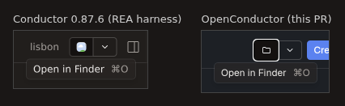 | 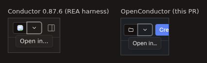 |
| 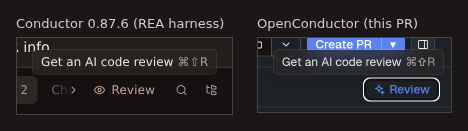 | 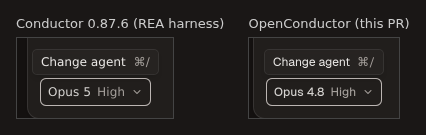 |
| 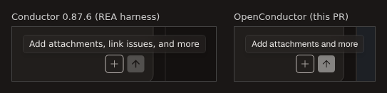 | 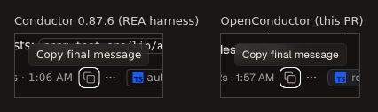 |
| 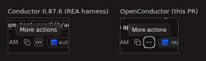 | 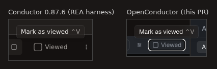 |
| 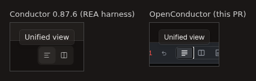 | 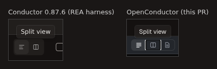 |
| 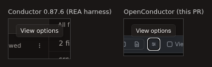 | |

Raw crops are in [raw/](raw), including Sven's native capture [raw/conductor-native-new-chat.png](raw/conductor-native-new-chat.png) ("New chat, same files ⌘T").

## Button inventory

Conductor's text, side and shortcut were read from the bundle call sites and confirmed by focusing each button in the REA harness. The delay is 600 ms everywhere unless noted.

| Screen | Element | Conductor tooltip (side) | Before | Now |
|---|---|---|---|---|
| header | Open in default app | "Open in Finder" + `workspace.openInApp` hint (bottom; `yvs`, wrapped in `div.flex.items-center.gap-1`) | `title` | match |
| header | Open in… chevron | "Open in..." (bottom) | `title` | match |
| header | Create PR | none: the header passes `showTooltips:!1` to `jds` | `title` | match (removed) |
| header | Toggle right sidebar | native `title` "Toggle right sidebar ⌘⌥B" (no Base UI tooltip) | native `title` from #504 | unchanged |
| header | Archive | none | moved to the sidebar row menu by #504 | n/a |
| header | PR status pill / PR link | "View PR status"; "<label> " + `git.openInGitHub` | `title` (different text) | gap: our PR pill is a different control (sidebar/PR owner) |
| chat tabs | + new chat | "New chat, same files" + `nav.newTab`, or "Maximum N tabs allowed" at the cap (`g8i`) | no + button | gap: our chat tab strip has no + yet |
| chat tabs | tab / close tab | none | `title` | match (removed) |
| transcript | Copy final message | "Copy final message"; "Copied!" for 2 s after a click (`t0`) | `title` | match (ours says "Copied!" for 1.5 s) |
| transcript | Show message actions | "More actions" | `title` | match |
| transcript | Turn time | none (popover on click) | `title` | unchanged: a span with turn details, not a button |
| composer | Model picker | "Change agent" + `chat.openModelPicker` in a `
` | `title` = model name | match |
| composer | Add | "Add attachments and more", or "…, link issues, and more" when issue links are allowed | `title` | match (we have no issue links, so the short text) |
| composer | Send / Queue | "Send message" / "Queue message" + `chat.submitMessage` (`Igo`) | `title` | wired. The harness showed no tooltip with an empty composer: the button is disabled, so Base UI never focuses it |
| composer | Stop | "Cancel " + `chat.cancel` (`Tgo`) | `title` "Stop the agent" | match ("Cancel ⌘⇧⌫") |
| changes | Review | "Get an AI code review " + `workspace.showReview` | `title` with a right-click note | match |
| changes | Filter files / Show folder hierarchy / Options | "Filter files", "Show folder hierarchy", "Options" | no such buttons | gap: other owners' Changes-toolbar controls |
| changes | Row discard | Conductor's row revert has no tooltip; `iyi` "Discard changes" is on the All-files tree row | `title` | match on our diff header; our list row keeps a tooltip (harmless extra) |
| changes | Refresh | none in Conductor (no such button) | `title` | unchanged (OpenConductor-only control) |
| diff | Unified / Split / Entire file | "Unified view", "Split view", "Entire file" (`UPo`) | `title` | match |
| diff | Viewed | "Mark as viewed" / "Mark as not viewed" + `diff.toggleViewed` | `title` | match |
| diff | View options | "View options" (`kPo`) | `title` | match |
| diff | Unsaved dot | "Unsaved changes" (`DPo`) | `title` | match |
| diff | Back to all changes | "Back to all changes" (turn view) | no turn view | gap |
| Checks | Re-run | "Re-run failed checks" (`OKo`) | `title` | match |
| Checks | Fix errors | none | `title` | match (removed) |

## Checks

- `npm run typecheck`: passed.
- `node --test "src/**/*.test.ts"`: 870 passed, 0 failed (after rebasing on origin/main 9876538) (`npm run build` also passes), including 4 new tests in `tooltipModel.test.ts`: default `nav.newTab` gives "New chat, same files ⌘T", a remap gives ⌘⇧N, an unbound command shows no hint, and Enter becomes an icon token.
- On screen: the Vite frontend with `?demo=1` in headless Chromium. Every converted button was focused and its popup read back. Hover timing was checked on Review and Discard: no popup at 350 ms, popup at 644-708 ms.

## Not verified

- The built Tauri app (WebKitGTK) was not run for this change. Only the Vite frontend in Chromium was checked.
- The chat-tab + tooltip has nothing to attach to until our chat tab strip gets its + button. The primitive supports both of its texts.
- The light theme was not captured. Its tokens come from the same `css-tokens.json` block.

## REA gaps hit

- `capture-browser-scenario` has no `hover` or pointer-move action (actions: click, fill, goto, press, request, select_option, wait_for, wait_for_timeout, check/uncheck). Tooltips cannot be captured through REA itself, so these crops come from Playwright on the same `tools/screens` harness.
- In that harness, Playwright mouse moves never reach Conductor's page (zero `pointermove` events on window). Sidebar clicks also do nothing there, although the same click works through REA. Workaround: open `/repository/<repo>/workspace/<id>` directly, then open tooltips with keyboard focus (Base UI opens on `:focus-visible`). This explains why disabled buttons (Send with an empty composer) cannot be captured.

## Rebase onto main 790305f7 (theme tokens)

Main now keeps every colour in `src/theme/tokens.css` (palettes, `npm run lint:colors`). The tooltip no longer defines its own `--popover*` / `--muted-foreground` on `:root`, which would have overridden the palettes. It now reads the theme's `--popover`, `--popover-text`, `--popover-ring`, `--muted` and `--shadow-10`. Under the Stone palette (Conductor's colours) the computed styles are unchanged: background `#2c2826` at 50%, text `#eae8e6`, ring `#ffffff1a`, 10% black shadow, 12px. Under the default Neutral palette it uses Neutral's greys. Captures: [raw/openconductor-open-in-finder-stone-tokens.png](raw/openconductor-open-in-finder-stone-tokens.png), [raw/openconductor-open-in-finder-neutral-tokens.png](raw/openconductor-open-in-finder-neutral-tokens.png). The rebase also kept main's new `Fix errors` button in the Checks tab, without the `title` (Conductor shows no tooltip there).
